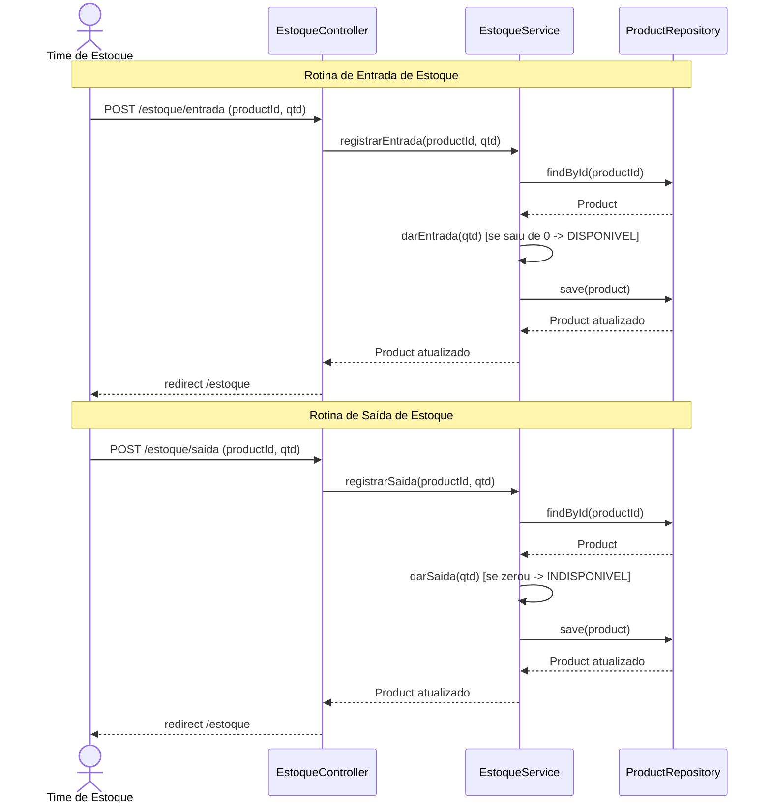
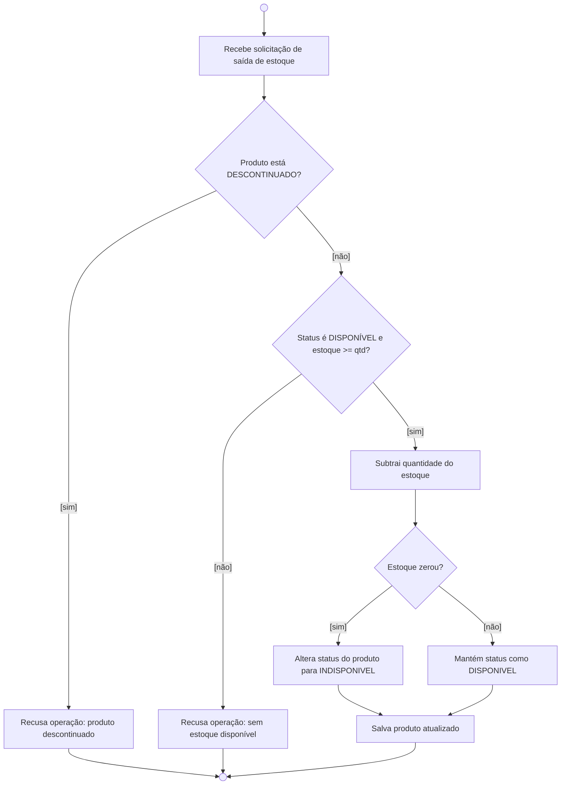
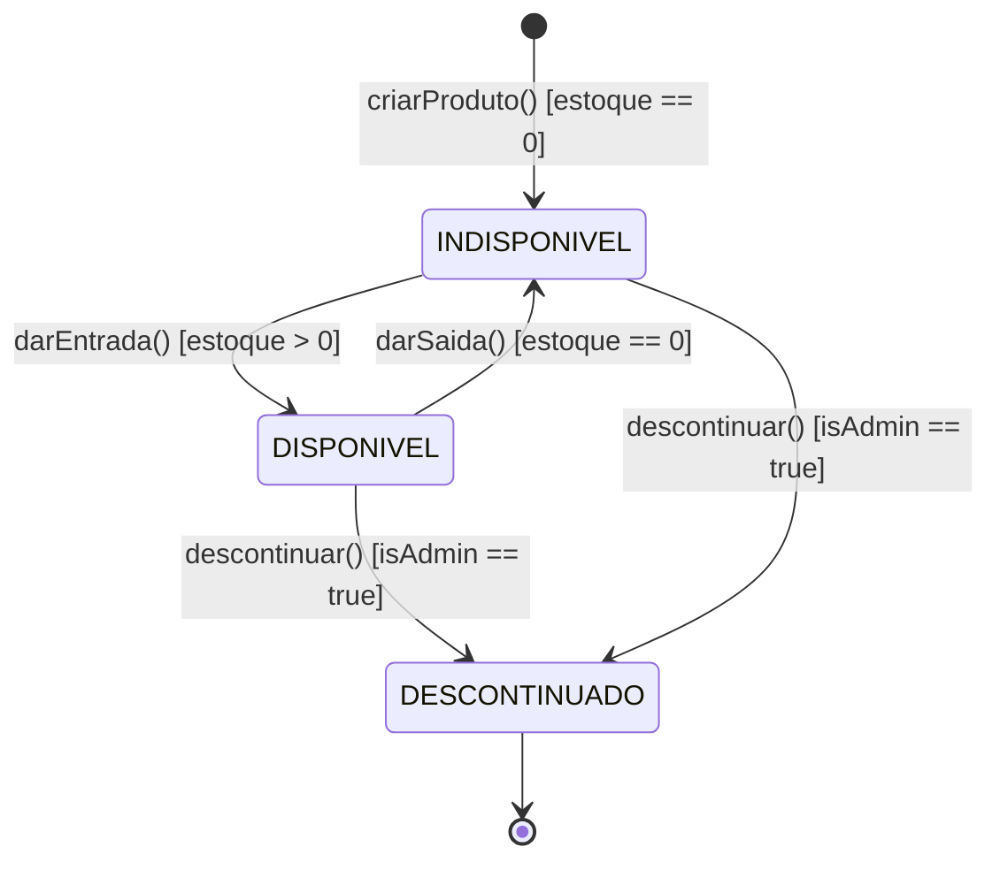

# Aula 6 — Estruturas dinâmicas (módulo de Estoque no MVC)

Projeto Spring Boot + Thymeleaf + H2 (`mvn spring-boot:run`, porta 8080).
Telas: `/products` (cadastro) e `/estoque` (entrada, saída, descontinuar).

Cada diagrama responde uma pergunta diferente (arquivos `.mermaid` em Mermaid):

| Diagrama | Pergunta | Arquivo |
|---|---|---|
| Sequência | Quem chama quem, e em que ordem? | `diagrama-sequencia-estoque.mermaid` |
| Atividades | Quais passos o processo executa? | `diagrama-atividade-saida-estoque.mermaid` |
| Estados | Em que estado o objeto está e como muda? | `diagrama-estado-produto.mermaid` |

## Diagrama de sequência — entrada e saída de estoque

## Diagrama de atividades — saída de estoque

## Diagrama de estados — Product

## Correspondência diagrama → código

- Estados e transições: `model/Product.java` (`darEntrada`, `darSaida`, `descontinuar`) e `ProductStatus`.
- Fluxo da sequência: `EstoqueController` → `EstoqueService` → `ProductRepository`.
- Decisões do diagrama de atividades: validações em `Product.darSaida`.

