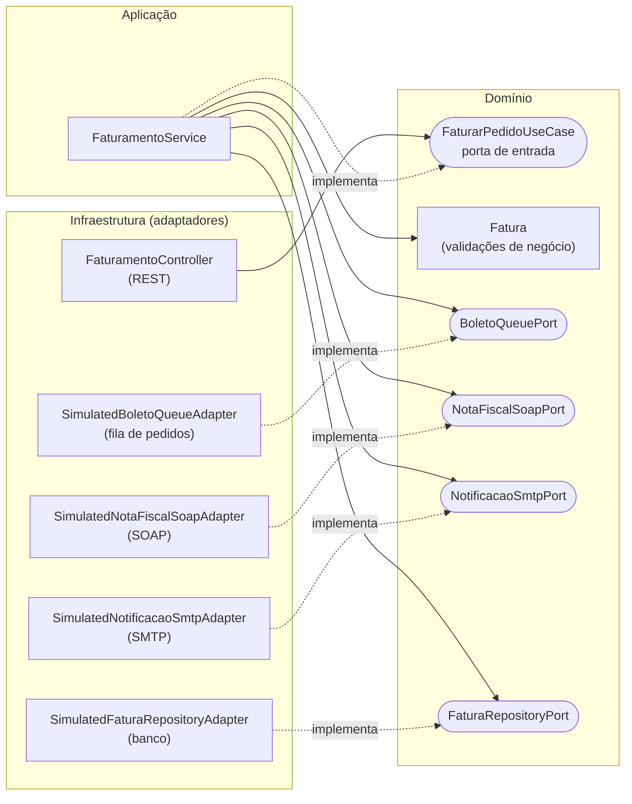

# Aula 7 — Hub de Faturamento em Arquitetura Hexagonal

Projeto Spring Boot (`mvn spring-boot:run`, porta **8081**). Nenhum serviço externo é necessário:
fila, SOAP, SMTP e banco são **adaptadores simulados**, o que mostra o ponto da aula
(trocar uma tecnologia = trocar um adaptador).

## O hexágono



## Mapa slide → código

| Conceito (slides) | Onde está |
|---|---|
| Entidade com validações ("Fatura com valor zero não existe") | `domain/model/Fatura.java` |
| Contrato de entrada | `domain/ports/in/FaturarPedidoUseCase.java` |
| Contratos de saída (linguagem do negócio) | `domain/ports/out/*Port.java` |
| Serviço: implementa a entrada, usa a saída, regras da aplicação ("emissor fora do ar?") | `application/service/FaturamentoService.java` |
| Adaptador de entrada (REST) + tradução de erros para HTTP | `adapters/in/web/` |
| Adaptadores de saída (fila, SOAP, SMTP, banco) | `adapters/out/*` |

## Regra de dependência

- `domain` não importa nada de Spring nem de `application`/`adapters` (conhece só a si mesmo).
- `application` importa apenas `domain` (a anotação `@Service` é a única marca de framework).
- `adapters` importam `domain` e implementam/consomem suas portas.

## Fluxo de `POST /api/faturas`

1. O adaptador REST recebe o pedido e chama a porta de entrada.
2. O serviço cria a `Fatura` (a entidade valida) e a guarda pela porta do banco.
3. Boleto (fila) → código de barras; nota (SOAP) → chave de 44 dígitos; e-mail (SMTP) → hash SHA-256.
4. Devolve o `faturaId`. Valor ≤ 0 → **422**; emissor falhou → **503**.

```bash
curl -X POST localhost:8081/api/faturas -H "Content-Type: application/json" \
  -d '{"pedidoId":1,"clienteNome":"Ana","clienteEmail":"ana@x.com","valorTotal":500}'
```

